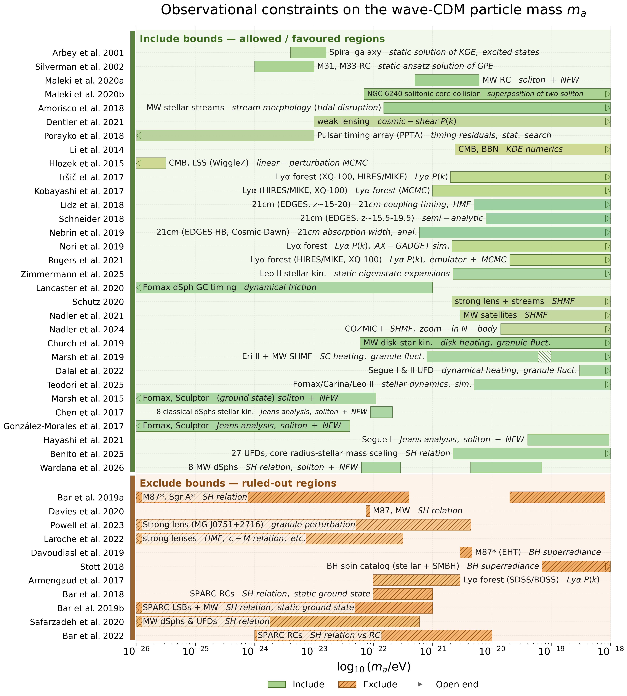

# WaveDM.jl

[](https://codecov.io/github/JuliaAstroSim/WaveDM.jl)
[](https://juliaastrosim.github.io/WaveDM.jl/)
[](https://www.gnu.org/licenses/gpl-3.0)
[](https://julialang.org/)

**WaveDM.jl: An Adaptable Simulation Framework for Dynamics of Baryonic and Wave Dark Matter on Galaxy Scales**

> 👋 **First time here?** Open the [Quickstart](https://juliaastrosim.github.io/WaveDM.jl/dev/quickstart/) — it walks you through picking a model and running Crater II in under 10 minutes.

WaveDM.jl is an open-source Julia package for high-performance simulations of wave (fuzzy) dark matter dynamics at galaxy scales.
The code solves the time-dependent **Schrödinger–Poisson equation (SPE)** with a second-order pseudo-spectral split-step Fourier method.
Its design philosophy centers on **adaptability** — making galaxy-scale simulations accessible to a broad range of astrophysicists — and **extensibility**, so the codebase can grow as a community-oriented project within the Julia ecosystem.

## What's in the box — at a glance

| Built-in preset                   | `model = …` keyword                   | What you get                                               |
| --------------------------------- | ----------------------------------    | ---------------------------------------------------------  |
| Crater II, Draco, Fornax, …       | `:dwarf_UFDs`                         | Ultra-faint dwarf halos (table via `list_galaxies()`)      |
| Generic dwarf, NFW / gNFW / Zhao  | `:dwarf`, `:dwarf_NFW`, `:dwarf_Zhao` | Customisable dwarf halos                                   |
| Milky Way (Zhu 2023 mass model)   | `:MW`                                 | Realistic host potential, with or without live baryons     |
| Early-type galaxy                 | `:Elliptical`                         | gNFW halo + Jaffe stellar profile                          |
| Galaxy cluster                    | `:cluster_NFW`, `:cluster_Burkert`    | NFW or Burkert halo + β-model ICM                          |
| Custom Schrödinger problem        | any model + `IC_vel`, `V`             | NLO, BEC, optical lattices (see Examples §6 of code paper) |

**Beginner-friendly introspectors:**

```julia
using WaveDM
WaveDM.print_catalog()                  # full model × baryon_mode × galaxy table
WaveDM.list_supported_models()           # programmatic access
WaveDM.list_galaxies()                   # every UFD with L, b, rho0 (Hayashi 2023)
# Per-catalog accessors and 1-based-id helpers:
WaveDM.list_MW_satellites()              # Battaglia 2022 MW satellites
WaveDM.list_SPARC_LTGs()                 # SPARC late-type galaxies
WaveDM.list_cooke_dwarfs()               # Cooke 2022 massive-dwarf names
WaveDM.ufd_index(df, Galaxy_id)          # → row index (uniform error message)
```

---

## At a Glance

- **Coupled wave + N-body evolution** of wave dark matter halos and baryonic components (mesh / static / dynamic particles) on the same grid.
- **Time-dependent tidal fields** from the Milky Way and external perturbers such as the LMC, with backward-in-time satellite trajectories.
- **Multi-level parallel execution**: shared-memory multi-threading, distributed-memory (Julia `Distributed.jl`), and GPU acceleration (`CUDA.jl`) — the same script runs on CPU, multi-threaded, and GPU configurations; distributed workers accelerate IC generation and N-body work, while the full SPE loop runs on one process in this release.
- **Galaxy-simulation toolbox**: gNFW / NFW / Zhao initial-condition generators, Milky-Way mass model (Zhu 2023), MW satellite trajectory lookback (Battaglia 2022), MW/LMC tidal fields, virial and QSS diagnostics, real-time visualization.
- **Cross-disciplinary GNLSE interface** — astrophysics, nonlinear optics and cold-atom physics share the same solver through a pluggable potential $V(\mathbf r, t, \psi)$.

---

## Installation

1. Install **Julia ≥ 1.12** from [julialang.org](https://julialang.org/downloads/).
2. Open Julia, press `]` for package mode, then run

   ```julia
   pkg> add https://github.com/JuliaAstroSim/WaveDM.jl

   # pkg> add WaveDM  # This will be supported soon
   ```

3. (Optional) GPU acceleration requires an NVIDIA GPU, the CUDA toolkit, and the `CUDA.jl` Julia package.

For development:

```bash
git clone https://github.com/JuliaAstroSim/WaveDM.jl.git
cd WaveDM.jl
julia --project -e "using Pkg; Pkg.develop(Pkg.PackageSpec(path='.'))"
```

---

## Quick Start — Wave CDM Evolution of Crater II

The shortest useful script: an ultra-faint dwarf (Crater II) under the SPE solver, with the LMC-enabled MW tidal field switched off for a clean virialization:

```julia
using WaveDM
using Unitful

simulate_waveDM(;
    model           = :dwarf_UFDs,
    Galaxy_id       = 6,                  # Crater II — try other ids via list_galaxies()
    baryon_mode     = :ignored,            # this preset has no baryonic model
    mₐ              = 50 * 1e-22 * 1.783e-36u"kg",  # m₂₂ = 50
    V               = (x, y, z, ψ) -> 0.0,
    Nx              = 128,                # 128³ is a smoke test; use 384³ for production runs
    Xmax            = 20u"kpc",
    Tmax            = 1.0u"Gyr",          # shorten for smoke test; 6 Gyr for production
    autoset_timestep = true,
    gpu             = false,              # set true if you have a CUDA GPU
    Realtime        = false,              # set true if you have a monitor
    title           = "TestRun",
)
```

> 💡 **First time?** Run `WaveDM.print_catalog()` after `using WaveDM` to see every supported model and ultra-faint dwarf Galaxy_id.

Add the time-dependent MW tidal field, optionally perturbed by the LMC:

```julia
simulate_waveDM(;
    model            = :dwarf_UFDs,
    Galaxy_id        = 6,
    baryon_mode      = :ignored,
    mₐ               = 50 * 1e-22 * 1.783e-36u"kg",
    V                = (x, y, z, ψ) -> 0.0,
    Nx               = 384,
    Xmax             = 20u"kpc",
    Tmax             = 6.0u"Gyr",
    autoset_timestep = true,
    MW_tidal_field   = true,              # time-dependent MW tidal field
    df_traj          = df_traj,           # from the lookback step (see docs Examples §4)
    tidal_lookback_time = 6.0u"Gyr",
    LMC_tidal_field  = true,              # include the LMC perturbation
    gpu              = true,
    title            = "CraterII_MW_LMC",
)
```

A halo that has reached **virialization** in the periodic-domain sense (no MW field) ends up in a **tide-driven non-equilibrium state** once the live MW tidal field is turned on — a useful diagnostic for stripping studies.

---

## Architecture

<picture>
  <source srcset="https://raw.githubusercontent.com/JuliaAstroSim/WaveDM.jl/main/docs/src/assets/WaveDM_architecture.png" type="application/png">
  
</picture>

*Figure: Architecture of WaveDM.jl (taken from the accompanying paper, Meng & Dong 2026).*

## Observational constraints on the ultralight dark-matter mass



The plot above summarises 42 observational and theoretical bounds on the wave-CDM particle mass $m_a$ from the literature. The rows follow the order of the source table and are split into **include bounds** (green — allowed / favoured regions) and **exclude bounds** (orange, hatched — ruled-out regions); the shade of each bar encodes its dataset family (rotation curves, dwarf galaxies, Lyα forest, 21 cm, CMB, lensing, black holes, …). Every paper occupies exactly one row, labelled `FirstAuthor et al. Year` (with `a`/`b` suffixes when two different papers share a label); a work that quotes two intervals — Bar et al. 2019, Marsh et al. 2019 — draws two bars on its row. The `data — method` annotation next to each bar uses standard abbreviations (`RC` = rotation curve, `SH relation` = soliton–halo relation, `SHMF` = subhalo mass function, `Lyα P(k)` = Lyα flux power spectrum), an arrowhead marks a bound that continues past the plotted mass range, and a hatched cap marks a bound whose quoted value is itself a range. The vector PDF — [`ma_constraints.pdf`](docs/src/assets/ma_constraints.pdf) — is searchable and copy-able for reuse in papers. The interactive HTML version (hover for citekey/title/DOI) is on the [documentation home page](https://juliaastrosim.github.io/WaveDM.jl/dev/). Raw constraint table: [`docs/constraints/ma_constraints.tex`](https://github.com/JuliaAstroSim/WaveDM.jl/blob/main/docs/constraints/ma_constraints.tex); regeneration recipe: [`docs/constraints/README.md`](https://github.com/JuliaAstroSim/WaveDM.jl/blob/main/docs/constraints/README.md).

WaveDM.jl integrates four core components on top of the shared [JuliaAstroSim](https://github.com/JuliaAstroSim) infrastructure:

1. a **pseudo-spectral split-step Fourier method (SSFM)** solver for the SPE, evolving $\psi$ with a second-order *kick–drift–kick* (KDK) scheme;
2. an optional **baryonic physics module** (`AstroNbodySim.jl`) with mesh-based and particle-based treatments (`baryon_mode = :ignored | :mesh | :particles_static | :particles_dynamic`);
3. a **galaxy-simulation toolbox** providing trajectory lookback, tidal-field evaluation, virial diagnostics, profile/RC fitting, real-time visualization, and post-processing;
4. a **multi-level parallel framework** combining multi-threading, distributed-memory (`Distributed.jl` with TCP/IP transport), and GPU acceleration (`CUDA.jl`).

Initial conditions are generated by `AstroIC.jl`; snapshot I/O is handled by `AstroIO.jl`. **Gas dynamics via SPH is planned for a future release.**

---

## Three Key Capabilities

### 1. Coupled wave + N-body evolution

The SPE solver evolves the bosonic field $\psi$ on a uniform Cartesian grid, while `AstroNbodySim.jl` simultaneously evolves baryonic particles (static or fully dynamic) and computes their gravitational coupling to the wave dark matter. Time-dependent tidal fields from a host halo and external perturbers (e.g. the LMC) are supported. Both `DirectSum` ($\mathcal{O}(N^2)$) and `Tree` ($\mathcal{O}(N \log N)$, Gadget-2 scheme) gravity solvers are available.

### 2. Multi-level parallel execution

Shared-memory multi-threading, distributed-memory parallelism via Julia's native `Distributed.jl`, and GPU acceleration via `CUDA.jl` are all exposed through simple keyword arguments (`julia -t N`, `distributed_memory=true`, `gpu=true`). The same script runs unchanged on CPU, multi-threaded, and GPU configurations. Distributed workers currently accelerate IC generation and N-body work; the distributed FFT Poisson solver is not implemented, so the full SPE loop runs on one process. MPI support is planned for a future release.

```julia
using Distributed
addprocs(4)
@everywhere using WaveDM

# Distributed-memory IC generation; the SPE loop itself remains single-process.
simulate_waveDM(; Nx = Ny = Nz = 256, distributed_memory = true, gpu = false,
                   IC_only = true, ...)
```

### 3. Galaxy-simulation toolbox

Ready-to-use density profiles (gNFW, NFW, Zhao, β-model), the Milky-Way mass model from Zhu et al. (2023), MW-satellite trajectory lookback from Battaglia et al. (2022), MW/LMC tidal fields, on-the-fly virial and energy diagnostics, profile and rotation-curve fitting, and interactive 2D/3D visualization through `GLMakie.jl` (with terminal-based `UnicodePlots.jl` for headless runs).

---

## Theoretical Background

Wave (or "fuzzy") dark matter describes dark matter as an ultralight bosonic field with particle masses $m_a \sim 10^{-23}$–$10^{-20}$ eV [Hu et al. 2000; Hui 2021]. For $m_a = 10^{-22}$ eV and a characteristic halo velocity $v \sim 100$ km s$^{-1}$, the de Broglie wavelength

```math
\lambda_{\rm dB} \;\equiv\; \frac{h}{m_a\,v} \;\approx\; 1.2\;{\rm kpc}
```

reaches astrophysical scales — comparable to galactic substructure. The macroscopic wavefunction $\psi(\mathbf r, t)$ is governed by the **Gross–Pitaevskii equation** (GPE), coupled self-consistently with the **Poisson equation** of gravity. In WaveDM.jl's dimensionless units (Edwards et al. 2018; Glennon et al. 2021), the SPE reads

```math
\begin{aligned}
i\,\partial_t \psi &= -\tfrac{1}{2}\nabla^2 \psi + \Phi_{\rm total}\,\psi, \\
\nabla^2 \Phi_{\rm total} &= 4\pi\bigl(\rho_{\rm DM} + \rho_{\rm baryon}\bigr),
\end{aligned}
```

with $\rho_{\rm DM} = |\psi|^2$. The package also supports the **generalized nonlinear Schrödinger equation**

```math
i\,\partial_t \psi(\mathbf r, t) \;=\; -\tfrac{1}{2}\nabla^2\psi \;+\; V(\mathbf r, t, \psi)\,\psi,
```

where $V$ is an arbitrary pluggable potential — local ($V = F(|\psi|)$, e.g. Kerr nonlinearity) or nonlocal (e.g. Poisson self-gravity, dipole–dipole, thermal-optical). This is the foundation of WaveDM.jl's cross-disciplinary applicability to nonlinear optics and cold-atom physics.

---

## Usage Examples

### Isolated halo simulation

An isolated halo with a gNFW initial profile, no baryons, no external tidal field — the cleanest setup for benchmarking the SPE solver:

```julia
using WaveDM
using Unitful

simulate_waveDM(;
    model           = :dwarf_UFDs,
    Galaxy_id       = 6,                  # Crater II
    baryon_mode     = :ignored,
    mₐ              = 50 * 1e-22 * 1.783e-36u"kg",
    V               = (x, y, z, ψ) -> 0.0,
    Nx              = 384,
    Xmax            = 20u"kpc",
    Tmax            = 6.0u"Gyr",
    autoset_timestep = true,
    gpu             = true,
    Realtime        = true,
)
```

### Baryonic component integration

Place the Milky Way's baryons on a fixed N-body background by sampling them with `AstroIC.ExponentialDisc` and switching to `baryon_mode = :particles_static`:

```julia
using WaveDM, AstroIC
using PhysicalParticles, UnitfulAstro, Unitful

particles_stellar_thin = generate(
    AstroIC.ExponentialDisc(;
        collection   = STAR,
        NumSamples   = 50_000,
        TotalMass    = 3.5e10u"Msun",
        ScaleRadius  = 2.42u"kpc",
        ScaleHeight  = 0.30u"kpc",
    )
)

particles_gas_HI = generate(
    AstroIC.ExponentialDisc(;
        collection   = GAS,
        NumSamples   = 30_000,
        TotalMass    = 8.0e9u"Msun",
        ScaleRadius  = 7.0u"kpc",
        ScaleHeight  = 0.085u"kpc",
        HoleRadius   = 4.0u"kpc",
    )
)

simulate_waveDM(;
    model              = :MW,
    baryon_mode        = :particles_static,
    baryon_particles   = [particles_stellar_thin; particles_gas_HI],
    GravitySolver      = Tree(),
    SofteningLength    = 0.1u"kpc",          # code default; ε ~ mean particle spacing
    Nx = Ny = Nz = 256,
    Xmax               = 100u"kpc",
    Tmax               = 3.0u"Gyr",
    autoset_timestep   = true,
    gpu                = true,
)
```

For full coupled evolution (wave DM ↔ baryons), use `baryon_mode = :particles_dynamic`. See the [Examples](https://juliaastrosim.github.io/WaveDM.jl/dev/examples/) page in the documentation for more.

---

## Documentation

The full documentation is available at **[juliaastrosim.github.io/WaveDM.jl](https://juliaastrosim.github.io/WaveDM.jl/)**.

- [Introduction](https://juliaastrosim.github.io/WaveDM.jl/dev/introduction/) — wave dark matter background, design philosophy, ecosystem
- [Installation](https://juliaastrosim.github.io/WaveDM.jl/dev/installation/) — installing WaveDM.jl and its dependencies
- [Algorithms](https://juliaastrosim.github.io/WaveDM.jl/dev/algorithms/) — SPE, split-step Fourier method, boundary conditions, resolution and timestep criteria, virial / QSS diagnostics
- [API Reference](https://juliaastrosim.github.io/WaveDM.jl/dev/api/configs/) — detailed API documentation
- [Examples](https://juliaastrosim.github.io/WaveDM.jl/dev/examples/) — end-to-end simulation examples
- [References](https://juliaastrosim.github.io/WaveDM.jl/dev/reference/) — related literature

---

## Performance Notes

- **Grid size**: powers of two (64, 128, 256, …) maximize FFT performance.
- **GPU**: most useful for grids $\gtrsim 256^3$; at large $N \gtrsim 512$, GPU memory can become the bottleneck.
- **Multi-threading**: launch with `julia -t N` and enable `FFTW.set_num_threads(N)` for FFT-bound work.
- **Distributed**: `addprocs(N)` then `distributed_memory = true`; uses `Distributed.jl` with TCP/IP transport (no MPI dependency). The distributed FFT Poisson solver is not implemented yet, so the full SPE loop must run on one process.
- **Visualization**: increase `StepsBetweenSnapshots` to reduce plotting overhead in long runs.

Detailed benchmarks on a 40-core + NVIDIA Tesla P100 node are reported in the accompanying paper (Meng & Dong 2026).

---

## Citation

If you use WaveDM.jl in your research, please cite the accompanying paper:

- **Meng, R. & Dong, X. 2026**, *WaveDM.jl: An Adaptable Simulation Framework for Dynamics of Baryonic and Wave Dark Matter on Galaxy Scales*, Research in Astronomy and Astrophysics — [journal article](http://iopscience.iop.org/article/10.1088/1674-4527/ae9042) · [arXiv:2606.25026](https://arxiv.org/abs/2606.25026) · DOI [10.1088/1674-4527/ae9042](https://doi.org/10.1088/1674-4527/ae9042)

```bibtex
@article{meng2026wavedmjladaptablea,
  title = {{{WaveDM}}.Jl: {{An Adaptable Simulation Framework}} for {{Dynamics}} of {{Baryonic}} and {{Wave Dark Matter}} on {{Galaxy Scales}}},
  shorttitle = {{{WaveDM}}.Jl},
  author = {Meng, Runyu and Dong, Xiaobo},
  year = 2026,
  journal = {Research in Astronomy and Astrophysics},
  issn = {1674-4527},
  doi = {10.1088/1674-4527/ae9042},
  url = {http://iopscience.iop.org/article/10.1088/1674-4527/ae9042},
  eprint = {2606.25026},
  archiveprefix = {arXiv},
  primaryclass = {astro-ph.GA},
  urldate = {2026-07-26}
}
```

Publications built on this code base:

- **Meng, R. & Dong, X. 2026**, *Wave Cold Dark Matter Can Reproduce the Radial Acceleration Relation in X-ray Elliptical Galaxies*, Research in Astronomy and Astrophysics — [journal article](http://iopscience.iop.org/article/10.1088/1674-4527/aeac08) · [arXiv:2610.18969](https://arxiv.org/abs/2610.18969) · DOI [10.1088/1674-4527/aeac08](https://doi.org/10.1088/1674-4527/aeac08)

```bibtex
@article{meng2026wavecold,
  title = {Wave {{Cold Dark Matter Can Reproduce}} the {{Radial Acceleration Relation}} in {{X}}-Ray {{Elliptical Galaxies}}},
  author = {Meng, Runyu and Dong, Xiaobo},
  year = 2026,
  journal = {Research in Astronomy and Astrophysics},
  issn = {1674-4527},
  doi = {10.1088/1674-4527/aeac08},
  url = {http://iopscience.iop.org/article/10.1088/1674-4527/aeac08},
  eprint = {2610.18969},
  archiveprefix = {arXiv},
  primaryclass = {astro-ph.GA},
  urldate = {2026-09-24}
}
```

The same entries are also collected in [`CITATION.bib`](CITATION.bib).

---

## License

WaveDM.jl is released under the **GNU General Public License v3.0 (GPL-3)**. See the [LICENSE](https://github.com/JuliaAstroSim/WaveDM.jl/blob/main/LICENSE) file for details.

---

## Related Packages

WaveDM.jl is part of the [JuliaAstroSim](https://github.com/JuliaAstroSim) ecosystem:

- [AstroSimBase.jl](https://github.com/JuliaAstroSim/AstroSimBase.jl) — basic types and interfaces
- [PhysicalParticles.jl](https://github.com/JuliaAstroSim/PhysicalParticles.jl) — N-body particles and vector algebra
- [AstroNbodySim.jl](https://github.com/JuliaAstroSim/AstroNbodySim.jl) — gravitational N-body simulations, glue layer, and parallel runtime
- [AstroIC.jl](https://github.com/JuliaAstroSim/AstroIC.jl) — initial condition generation
- [AstroIO.jl](https://github.com/JuliaAstroSim/AstroIO.jl) — snapshot I/O
- [AstroPlot.jl](https://github.com/JuliaAstroSim/AstroPlot.jl) — analysis and visualization
- [PhysicalFFT.jl](https://github.com/JuliaAstroSim/PhysicalFFT.jl) — FFT primitives for physical problems
- [PhysicalFDM.jl](https://github.com/JuliaAstroSim/PhysicalFDM.jl) — finite-difference operators
- [PhysicalTrees.jl](https://github.com/JuliaAstroSim/PhysicalTrees.jl) — tree gravity solver
- [PhysicalMeshes.jl](https://github.com/JuliaAstroSim/PhysicalMeshes.jl) — mesh-based gravity solver
- [GalacticDynamics.jl](https://github.com/JuliaAstroSim/GalacticDynamics.jl) — density profiles and orbit calculations

---

## Roadmap

Planned future developments include:

- **MPI support** as an alternative distributed-memory backend to `Distributed.jl`
- **SPH solver** for gaseous baryonic components
- **Adaptive timestep** for the SPE solver
- **Cosmological initial conditions** beyond idealized halos
- Extended cross-disciplinary support for **nonlinear optics** and **cold-atom physics**

Contributions are welcome — please open an issue or pull request on GitHub.

---

## Contact

For questions, issues, or feature requests, please open an issue on [GitHub](https://github.com/JuliaAstroSim/WaveDM.jl/issues).
