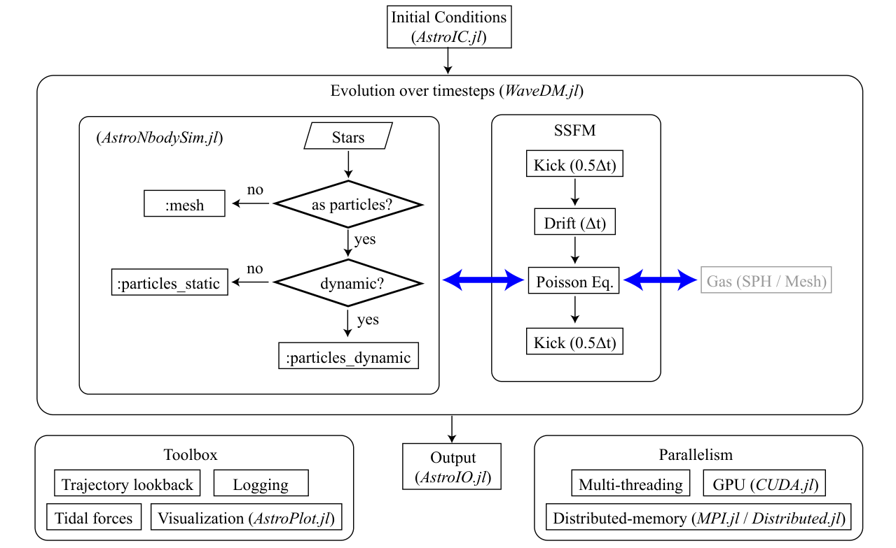

# WaveDM.jl

**WaveDM.jl: An Adaptable Simulation Framework for Dynamics of Baryonic and Wave Dark Matter on Galaxy Scales**

WaveDM.jl is an open-source Julia package for high-performance simulations of wave (fuzzy) dark matter dynamics on galaxy scales.
The code solves the time-dependent **Schrödinger–Poisson equation (SPE)** using a pseudo-spectral split-step Fourier method, with a design philosophy centered on **adaptability and extensibility**.

The spectral solver is tightly integrated with N-body gravitational force solvers, enabling simultaneous evolution of wave dark matter and baryonic components in galaxy-scale simulations.
A unified multi-level parallelization framework brings shared-memory, distributed-memory, and GPU execution into a single workflow. The same code runs across CPU, multi-threaded, and GPU configurations; distributed workers currently accelerate initial-condition generation and N-body work, while the full SPE loop runs on a single process in this release.
A dedicated galaxy-simulation toolbox — built on `AstroIC.jl`, `AstroNbodySim.jl`, and `AstroPlot.jl` — bundles flexible initial condition generators, trajectory lookback, tidal force calculations, and real-time visualization.

Beyond astrophysics, the code's modular architecture supports cross-disciplinary studies in nonlinear optics and cold-atom physics through a generalized nonlinear Schrödinger interface.

## Three Key Capabilities

1. **Coupled wave + N-body evolution.** The SPE solver evolves the bosonic field $\psi$ on a uniform grid, while `AstroNbodySim.jl` simultaneously evolves baryonic particles (static or fully dynamic) and computes their gravitational coupling to the wave dark matter. Time-dependent tidal fields from a host halo and external perturbers (e.g. the LMC) are supported.
2. **Multi-level parallel execution.** Shared-memory multi-threading, distributed-memory parallelism via Julia's native `Distributed.jl`, and GPU acceleration via `CUDA.jl` are all exposed through simple keyword arguments (`-t N`, `distributed_memory=true`, `gpu=true`). The same script runs unchanged from a laptop to a multi-node cluster.
3. **Galaxy-simulation toolbox.** Ready-to-use density profiles (gNFW, NFW, Zhao), Milky-Way and SPARC initial conditions, Milky-Way satellite trajectory lookback (Battaglia 2022), MW / LMC tidal fields, on-the-fly virial and energy diagnostics, and interactive 2D/3D visualization via `GLMakie.jl` (and terminal-based `UnicodePlots.jl` for headless runs).

## Quick Start

The minimum useful script — wave CDM evolution of a Crater II-like ultra-faint dwarf:

```julia
using WaveDM
using Unitful

simulate_waveDM(;
    model       = :dwarf_UFDs,
    Galaxy_id   = 6,                # Crater II
    baryon_mode = :ignored,         # Crater II is dark-matter dominated
    mₐ          = 50 * 1e-22 * 1.783e-36u"kg",  # m₂₂ = 50
    V           = (x, y, z, ψ) -> 0.0,  # external potential
    Nx          = 384,              # mesh size
    Xmax        = 20u"kpc",         # half-side length, L = 2*Xmax
    Tmax        = 6.0u"Gyr",
    autoset_timestep = true,
    bulk_size   = 4,                # value used in the paper
    gpu         = true,
    Realtime    = true,
)
```

See [Examples](@ref) for additional end-to-end cases (Crater II with the MW tidal field, MW+LMC trajectory lookback, distributed-memory IC generation, GPU performance).

## Architecture



*Figure 1 — Architecture of WaveDM.jl.* The framework integrates four core components (reproduced from the accompanying paper, Meng & Dong 2026):

1. a **pseudo-spectral split-step Fourier method (SSFM)** solver for the SPE, evolving $\psi$ with a second-order *kick–drift–kick* (KDK) scheme;
2. an optional **baryonic physics module** (`AstroNbodySim.jl`) with mesh-based and particle-based treatments (`baryon_mode = :ignored | :mesh | :particles_static | :particles_dynamic`), supporting both `DirectSum` ($\mathcal{O}(N^2)$) and `Tree` ($\mathcal{O}(N \log N)$, Gadget-2 scheme) gravity solvers;
3. a **galaxy-simulation toolbox** providing trajectory lookback, tidal-field evaluation, logging, real-time visualization (`AstroPlot.jl`), and post-processing;
4. a **multi-level parallel framework** combining multi-threading, distributed-memory (Julia's `Distributed.jl` with TCP/IP transport), and GPU acceleration (`CUDA.jl`).

Initial conditions are generated by `AstroIC.jl`; snapshot I/O is handled by `AstroIO.jl`. **Gas dynamics via SPH is planned for a future release.** MPI support is also planned as an alternative communication backend to `Distributed.jl`.

## Observational constraints on the ultralight dark-matter mass

WaveDM.jl is designed for halo-scale simulations of fuzzy / wave dark matter, and a substantial literature already constrains the particle mass $m_a$ across more than nine orders of magnitude. The table below summarises 42 observational and theoretical bounds from the literature, grouped by data type.


*Static PNG (click to enlarge). The rows follow the order of [`ma_constraints.tex`](https://github.com/JuliaAstroSim/WaveDM.jl/blob/main/docs/constraints/ma_constraints.tex) and are split into **Include bounds — allowed / favoured regions** (green) and **Exclude bounds — ruled-out regions** (orange, hatched); within each group the shade of the bar encodes the dataset family (rotation curves, dwarf galaxies, Lyα forest, 21 cm, CMB, lensing, black holes, …) and a dashed guide marks every row. Every paper occupies exactly one row: works that quote two intervals (Bar et al. 2019, Marsh et al. 2019, Wardana et al. 2026 …) draw two bars on that row, and two *different* papers that share an author–year label get `a` / `b` suffixes. The `data — method` annotation of each bar uses standard abbreviations (`RC` = rotation curve, `SH relation` = soliton–halo relation, `SHMF` = subhalo mass function, `Lyα P(k)` = Lyα flux power spectrum); an arrowhead marks a bound that continues past the plotted range, and a hatched cap marks a bound whose quoted value is itself a range (Marsh & Niemeyer 2019). For a copy-able vector version use [ma_constraints.pdf](assets/ma_constraints.pdf).*

For the interactive version — hover any bar to see the citekey, year, title, authors, journal, DOI/arXiv link, raw constraint, and the bounding interval in $\log_{10}(m_a/\mathrm{eV})$ — open the plotly figure:

<iframe src="../assets/ma_constraints.html" width="100%" height="980" frameborder="0" loading="lazy" style="border:1px solid #ddd"></iframe>

A lightweight fallback (pure SVG, no JavaScript) is also available; click any rectangle in [ma_constraints.svg](assets/ma_constraints.svg) to open the paper DOI in a new tab.

The raw constraint table is in [`docs/constraints/ma_constraints.tex`](https://github.com/JuliaAstroSim/WaveDM.jl/blob/main/docs/constraints/ma_constraints.tex); the structured dataset is in [`docs/constraints/output/ma_constraints.yaml`](https://github.com/JuliaAstroSim/WaveDM.jl/blob/main/docs/constraints/output/ma_constraints.yaml); see [`docs/constraints/README.md`](https://github.com/JuliaAstroSim/WaveDM.jl/blob/main/docs/constraints/README.md) for how the figure is regenerated.

## When to use WaveDM.jl

| If you need … | WaveDM.jl provides … |
| --- | --- |
| Galaxy-scale SPE simulations with realistic halo potentials | `model = :MW`, `:dwarf`, `:dwarf_NFW`, `:dwarf_Zhao`, `:Elliptical`, `:cluster_NFW`, `:cluster_Burkert`; gNFW / NFW / Zhao / β-model / Jaffe profiles; the Milky-Way mass model (Zhu 2023); Crater II preset (`model = :dwarf_UFDs`, `Galaxy_id = 6`; for profile fitting set `target_profile_model = :dwarf_Zhao` and pass the Crater II `target_profile_*` parameters from `AstroIC.load_data_UFDs()`) |
| Tidal stripping of a satellite under a live host | `MW_tidal_field=true`, optional `LMC_tidal_field=true` |
| Backward orbital integration of a satellite | `AstroIC.load_data_MW_satellites()` + an `AstroNbodySim.Simulation` |
| Self-interacting wave dark matter ($\kappa \neq 0$) | Pluggable `V(x, y, z, ψ)` + `κ` keyword |
| Cross-disciplinary nonlinear Schrödinger problems | Pluggable potential interface — same code base for NLO, BEC |

## Documentation Navigation

- [**Quickstart**](quickstart.md) — for first-time users; choose a model, run Crater II in under 10 minutes
- [Introduction](introduction.md) — wave dark matter background, design philosophy, ecosystem, model decision tree
- [Installation](installation.md) — installing WaveDM.jl and its dependencies
- [Algorithms](algorithms.md) — SPE, split-step Fourier method, boundary conditions, resolution and timestep criteria, virial diagnostics
- [API Reference](api/configs.md) — detailed API documentation
- [Examples](examples.md) — complete simulation examples
- [References](reference.md) — related literature

## Citation

If you use WaveDM.jl in your research, please cite the accompanying paper:

- **Meng, R. & Dong, X. 2026**, *WaveDM.jl: An Adaptable Simulation Framework for Dynamics of Baryonic and Wave Dark Matter on Galaxy Scales*, Research in Astronomy and Astrophysics — [journal article](http://iopscience.iop.org/article/10.1088/1674-4527/ae9042) · [arXiv:2606.25026](https://arxiv.org/abs/2606.25026) · DOI [10.1088/1674-4527/ae9042](https://doi.org/10.1088/1674-4527/ae9042)

```bibtex
@article{meng2026wavedmjladaptablea,
  title = {{{WaveDM}}.Jl: {{An Adaptable Simulation Framework}} for {{Dynamics}} of {{Baryonic}} and {{Wave Dark Matter}} on {{Galaxy Scales}}},
  shorttitle = {{{WaveDM}}.Jl},
  author = {Meng, Runyu and Dong, Xiaobo},
  year = 2026,
  journal = {Research in Astronomy and Astrophysics},
  issn = {1674-4527},
  doi = {10.1088/1674-4527/ae9042},
  url = {http://iopscience.iop.org/article/10.1088/1674-4527/ae9042},
  eprint = {2606.25026},
  archiveprefix = {arXiv},
  primaryclass = {astro-ph.GA},
  urldate = {2026-07-26}
}
```

Publications built on this code base:

- **Meng, R. & Dong, X. 2026**, *Wave Cold Dark Matter Can Reproduce the Radial Acceleration Relation in X-ray Elliptical Galaxies*, Research in Astronomy and Astrophysics — [journal article](http://iopscience.iop.org/article/10.1088/1674-4527/aeac08) · [arXiv:2610.18969](https://arxiv.org/abs/2610.18969) · DOI [10.1088/1674-4527/aeac08](https://doi.org/10.1088/1674-4527/aeac08)

```bibtex
@article{meng2026wavecold,
  title = {Wave {{Cold Dark Matter Can Reproduce}} the {{Radial Acceleration Relation}} in {{X}}-Ray {{Elliptical Galaxies}}},
  author = {Meng, Runyu and Dong, Xiaobo},
  year = 2026,
  journal = {Research in Astronomy and Astrophysics},
  issn = {1674-4527},
  doi = {10.1088/1674-4527/aeac08},
  url = {http://iopscience.iop.org/article/10.1088/1674-4527/aeac08},
  eprint = {2610.18969},
  archiveprefix = {arXiv},
  primaryclass = {astro-ph.GA},
  urldate = {2026-09-24}
}
```

## License

WaveDM.jl is released under the **GNU General Public License v3.0 (GPL-3)**. See the [LICENSE](https://github.com/JuliaAstroSim/WaveDM.jl/blob/main/LICENSE) file for details.
